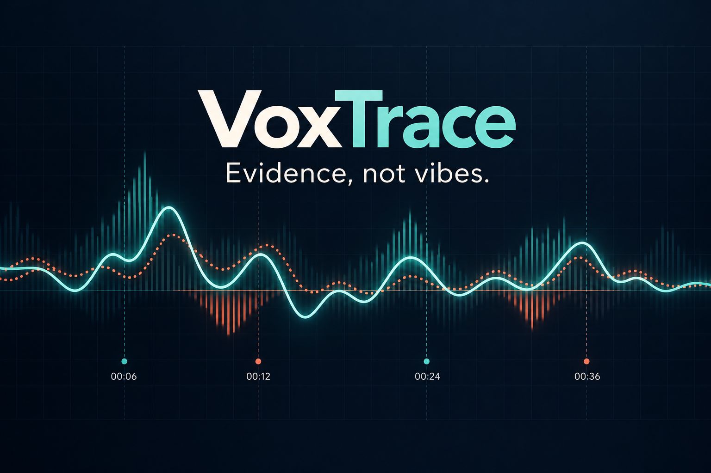
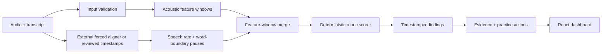

# VoxTrace

> An explainable speech coach that locates delivery flaws to the exact second.



[](https://www.python.org/)
[](https://fastapi.tiangolo.com/)
[](https://react.dev/)
[](#verification)
[](LICENSE)

VoxTrace is a Track C entry for the [Multimodal AI Hackathon 2026](https://multimodal-ai-hackathon-2026-7.devpost.com/). It turns a speech recording and transcript into timestamped delivery findings, measured acoustic evidence, and focused practice actions. The project is designed around a strict rule: if a number is not computed from the input, VoxTrace does not display it.

## Submission status

VoxTrace is an actively developed hackathon prototype. The deterministic analysis engine, ideal-vs-target comparison, optional phoneme forced-alignment path, dataset-generation tooling, evaluation tooling, and judge-facing dashboard work. An owner-only production preview is deployed; public access, the final licensed multi-speaker dataset, reviewed labels, measured held-out results, and video still require submission-owner input.

| Track C requirement | Current evidence | Status |
|---|---|---|
| Custom ideal-vs-flawed dataset | Versioned schema, generator, dataset card, manifest validator, speaker-held-out splitter, example manifests | In progress — real licensed recordings and reviewed labels are required |
| Forced alignment | Guarded optional WhisperX phoneme-alignment endpoint plus validated word-timestamp contracts | Implemented as an optional worker; model installation and pre-warming required |
| Acoustic features | dBFS energy, silence, F0, pitch variation, FFT descriptors, 13 cepstral coefficients, aligned speech rate and pauses | Implemented; clarity remains deliberately absent unless supplied by a validated method |
| Temporal flaw grounding | Deterministic window scoring with exact start/end timestamps | Implemented for supplied feature windows |
| Causal explanations | Every finding includes measured evidence and a practice action | Implemented |
| Interactive dashboard | Dual audio input, seeded demo, scorecard, data completeness, paired timeline, findings, limitations, and browser-local fallback | Implemented |
| Baseline comparison overlay | Measured ideal-vs-target windows and normalized same-script mapping | Implemented |
| Evaluation | Interval IoU, per-class precision/recall/F1, macro F1, and CLI report generation | Implemented tooling; real results pending dataset |
| Reproducibility | Dockerfile, pinned dependency ranges, deterministic logic, 24 backend tests | Implemented |

## What works today

- Upload a mono or stereo 16-bit PCM WAV file and extract one-second acoustic windows.
- Measure energy, conservative silence intervals, and pitch variation without inventing missing features.
- Accept externally forced-aligned or human-reviewed word timestamps and derive speech rate and word-boundary pauses.
- Score timestamped feature windows with a transparent, versionable threshold profile.
- Return exact flaw intervals for rushed delivery, excessive pauses, monotone delivery, low energy, and low clarity when the required measurements exist.
- Explain each finding with the observed value, configured threshold, and a concrete practice action.
- Run a polished seeded demo even when no audio file is available.
- Measure uploaded audio on-device with the Web Audio API if the Python service is unavailable; uploaded audio stays in the browser on this fallback path.
- Validate dataset manifests, create deterministic speaker-held-out splits, and evaluate labelled intervals.
- Compare ideal and target recordings of the same script and expose per-window observed, reference, and delta values.
- Generate a reviewable same-script stress spectrum from a licensed reference recording.

## Architecture



The current upload path handles measured WAV features. Word timing is only accepted from a real aligner or human review; VoxTrace never spreads transcript words evenly over the audio and calls that alignment. See [the architecture notes](docs/architecture.md) for the implemented and planned boundaries.

## Quick start

### Prerequisites

- Python 3.11 or newer
- Node.js 20 or newer
- npm

### 1. Start the API

Windows PowerShell:

```powershell
py -3.11 -m venv .venv
.\.venv\Scripts\python.exe -m pip install -r backend\requirements.txt
.\.venv\Scripts\python.exe -m uvicorn backend.app.main:app --reload
```

macOS/Linux:

```bash
python3 -m venv .venv
./.venv/bin/python -m pip install -r backend/requirements.txt
./.venv/bin/python -m uvicorn backend.app.main:app --reload
```

The API is available at `http://127.0.0.1:8000`; interactive documentation is at `http://127.0.0.1:8000/docs`.

### 2. Start the dashboard

In a second terminal:

```bash
cd frontend
npm ci
npm run dev
```

Open `http://127.0.0.1:5173`. Select **Run seeded analysis** for the deterministic judge demo, or upload a supported WAV file for measured acoustic analysis.

To use a non-default API URL, copy `.env.example` and set `VITE_API_URL` before starting the frontend.

## API

| Method | Route | Purpose |
|---|---|---|
| `GET` | `/health` | Health and version check |
| `POST` | `/v1/audio/feature-windows` | Validate a PCM WAV and return measured energy, silence, and pitch-variation windows |
| `POST` | `/v1/alignment/apply-word-timing` | Validate real word timestamps and derive WPM and word-boundary pauses |
| `POST` | `/v1/alignment/forced-align` | Run optional WhisperX phoneme forced alignment on a fixed transcript |
| `POST` | `/v1/analyze/windows` | Score timestamped features and return grounded findings |
| `POST` | `/v1/compare/windows` | Compare pre-extracted ideal and target windows |
| `POST` | `/v1/audio/compare` | Extract and compare two same-script WAV recordings |

The upload endpoint accepts files up to 20 MB and audio up to 10 minutes. Raw uploads are processed through a temporary file and deleted after extraction.

## Dataset workflow

The planned dataset, `VoxTrace-Contrastive-1`, pairs each script's reference delivery with deliberately flawed versions such as rushed, over-paused, monotone, low-energy, and mixed-flaw speech. Every redistributed recording must be original, public-domain, or covered by documented permission.

Each JSONL manifest record contains a recording ID, script ID, pseudonymous speaker ID, variant, source/licence, transcript, sampling metadata, and timestamped flaw labels. The final split is by speaker—not by recording—to prevent leakage.

Validate manifests and generate a deterministic held-out-speaker summary:

```bash
python -m backend.cli dataset-summary \
  --manifests data/labels/manifests.jsonl \
  --output data/processed/dataset-summary.json
```

Generate a reviewable stress spectrum from one licensed ideal-delivery WAV:

```bash
python -m backend.contrastive_cli \
  --reference reference.wav \
  --transcript "Your exact script" \
  --speaker-id speaker-01 \
  --script-id script-01 \
  --licence "Original recording, redistribution permitted" \
  --consent-record "consent-log: speaker-01" \
  --output data/voxtrace-contrastive-1
```

Generated labels are intentionally marked `pending`; a human must review their exact intervals before evaluation.

The repository currently includes only synthetic example metadata, not a completed dataset or competition results. See the [dataset card](docs/dataset-card.md).

## Evaluation

Generate measured JSON and Markdown reports after creating real predictions:

```bash
python -m backend.cli evaluate \
  --manifests data/labels/manifests.jsonl \
  --predictions data/processed/predictions.json \
  --json-output data/processed/evaluation.json \
  --markdown-output docs/evaluation-results.md
```

The evaluator reports interval IoU, per-category precision/recall/F1, macro F1, and mean matched IoU. No accuracy, F1, latency, user-study, or dataset-size claim should be made until it has been measured and committed. The full protocol is in [docs/evaluation.md](docs/evaluation.md).

## Verification

Backend tests:

```bash
python -m pytest -q
```

Frontend production build:

```bash
npm ci --prefix frontend
npm run build --prefix frontend
```

Verified on 10 October 2026:

- 24 backend tests passed.
- TypeScript compilation and Vite production build passed.

Container build and run:

```bash
docker build -t voxtrace .
docker run --rm -p 8000:8000 voxtrace
```

## Responsible use and limitations

- VoxTrace is an educational coaching prototype, not a medical, psychological, employment, or competition-judging system.
- Delivery conventions vary across cultures, languages, speaking styles, microphones, rooms, and recording conditions.
- The current lightweight pitch estimator is conservative and is not a substitute for a validated F0 pipeline.
- The current repository does not bundle a forced-alignment model.
- Transcript quality and alignment errors directly affect speech-rate and pause measurements.
- Raw speech may contain biometric or personal information. Do not publish a recording without the speaker's informed permission and an appropriate licence.
- A production service must add authentication, encryption, retention controls, and user-directed deletion before storing uploads.

## AI assistance disclosure

AI coding assistants are permitted by the hackathon but must be disclosed. This project used **ByteAsk / ChatGPT and OpenAI Codex** for planning, architecture discussion, code and test assistance, audit support, and documentation. Human contributors remain responsible for reviewing the implementation, licensing, measurements, and every submission claim. See [AI_ASSISTANCE.md](AI_ASSISTANCE.md).

No generative model is currently used at runtime to score speech. The current scoring path is deterministic and rule-based.

## Roadmap to submission

- [ ] Record or source a small, licensed contrastive dataset with the exact same scripts across the quality spectrum.
- [ ] Complete temporal labels and second-review a representative sample.
- [x] Integrate and document an optional phoneme forced-alignment engine.
- [x] Add F0, FFT/cepstral, energy, pause, rate, and spectral features.
- [x] Implement reference-vs-participant window comparison and visualization.
- [ ] Run held-out-speaker evaluation and publish only measured results.
- [x] Produce a standalone maximum six-page technical-report source.
- [x] Deploy and verify an owner-only production demo.
- [ ] Make the verified demo public after the submission owner approves public access.
- [ ] Record a 3–10 minute YouTube demo covering dataset construction, stress testing, and timestamped detections.
- [ ] Complete all Devpost fields, preview the public page, and submit before **15 October 2026 at 12:15 AM IST**.

## Repository map

```text
backend/                    FastAPI application and CLI
frontend/                   React + TypeScript dashboard
tests/                      Backend unit and API tests
data/labels/                Dataset manifests and examples
data/raw/                   Local-only/raw audio placeholder
data/processed/             Generated summaries and evaluation outputs
docs/architecture.md        Implemented and planned system boundaries
docs/dataset-card.md        Dataset purpose, schema, licences, and safeguards
docs/evaluation.md          Held-out evaluation protocol
docs/technical-report.tex   Standalone submission technical report
docs/devpost-submission.md  Prepared Devpost project story and metadata
docs/demo-script.md         Six-minute demonstration script
AI_ASSISTANCE.md            Required AI-tool disclosure
HACKATHON_MASTER_PLAN.md    Rubric mapping and delivery plan
```

## License

The source code is available under the [MIT License](LICENSE). Dataset and audio licences are separate and must be documented per recording; the MIT licence does not grant rights to third-party speech recordings.
